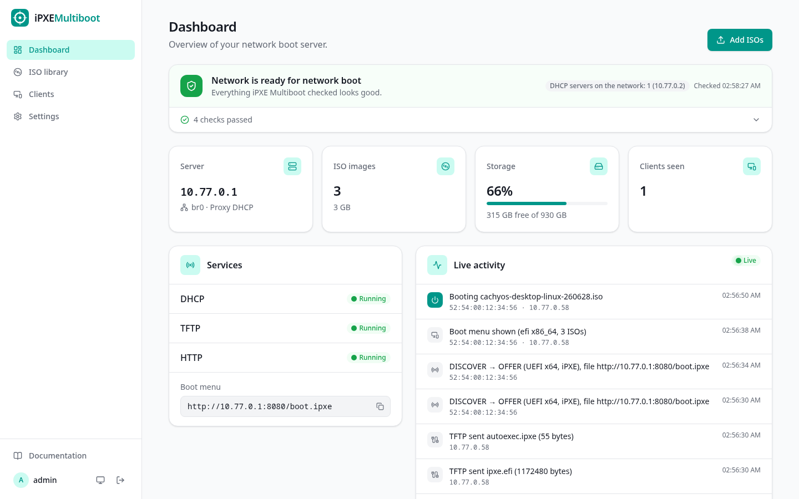
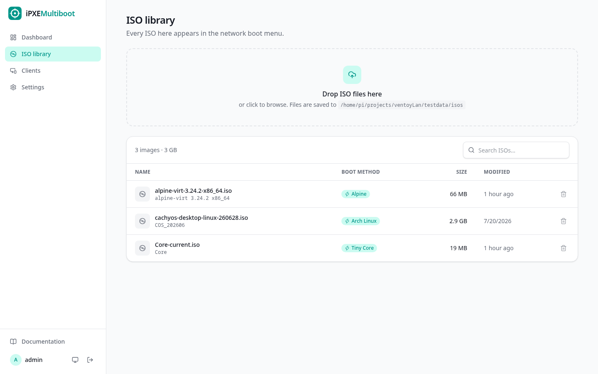
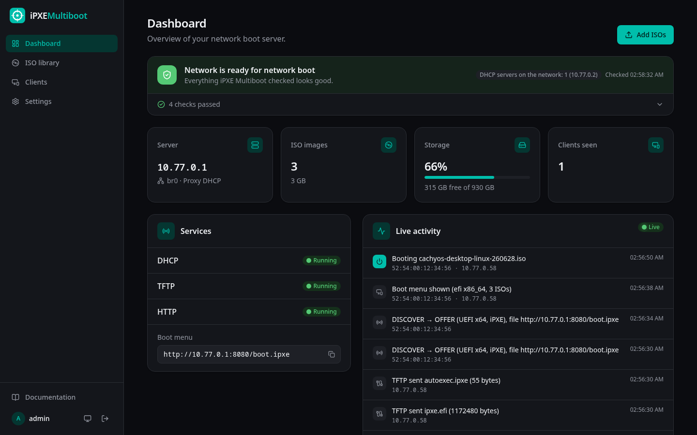
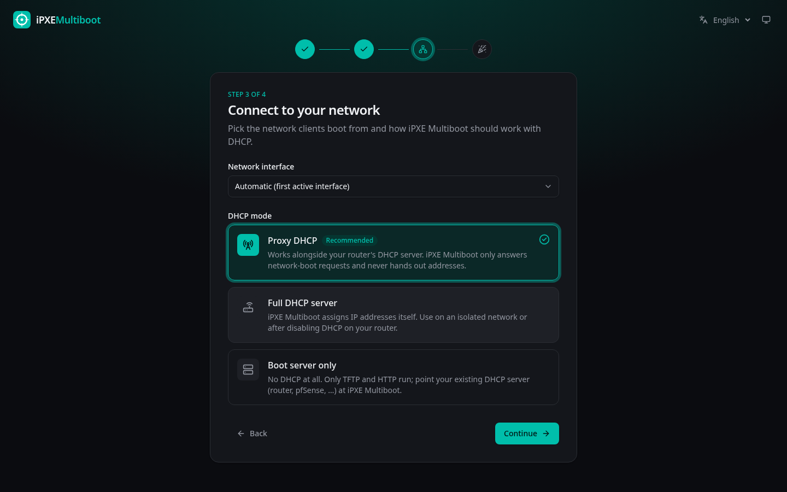
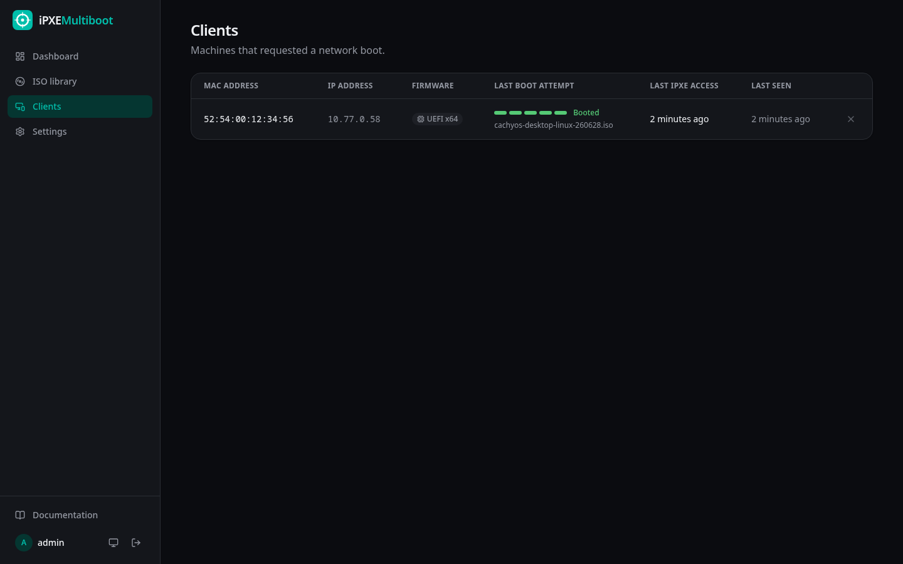

<div align="center">


# iPXE Multiboot

**Drop ISO files in a folder. Boot them on any machine in your network.**

A free and open source network boot (PXE) server with a modern web interface.
Inspired by iVentoy, but fully open source: no closed binaries and no kernel drivers injected into your installers.

[](https://github.com/haouarihk/ipxemultiboot/actions/workflows/ci.yml)
[](https://github.com/haouarihk/ipxemultiboot/releases)
[](LICENSE)



</div>

## Features

- **Zero-extraction ISO booting.** iPXE Multiboot reads ISO9660 images directly and serves the kernel, initrd and root filesystem *out of the ISO* over HTTP. Nothing gets unpacked or copied.
- **Works with your existing router.** The default *Proxy DHCP* mode answers only network-boot requests and never hands out addresses. You can also run it as a *full DHCP server*, or as a *boot server only* behind a DHCP server you configure yourself.
- **BIOS and UEFI.** Ships iPXE built from source, with legacy PXE, UEFI PXE and UEFI HTTP boot.
- **Automatic distro detection.** Arch and derivatives, Ubuntu and derivatives, Debian, Fedora/RHEL, Alpine and Tiny Core boot through native network recipes. Any other ISO falls back to iPXE `sanboot`.
- **Automatic network check.** Every time the dashboard loads, iPXE Multiboot scans the LAN for DHCP servers and competing PXE servers, checks your DHCP mode, interface, firewall and recent boot attempts, and suggests fixes. Some fixes can be applied with one click, such as "no DHCP server found → use Full DHCP with pool 192.168.1.100–199".
- **Client tracking.** It shows every machine that tried to network-boot, its firmware, its last iPXE access, and how far its last attempt got (boot offer → iPXE → menu → booted), with a hint where it got stuck.
- **Modern web interface.** It has drag-and-drop uploads with progress, a live boot activity feed, DHCP and network settings, light and dark themes, and English, Deutsch, Español, Français and 中文.
- **Single static binary.** It's written in Go with an embedded React UI and SQLite, and runs on amd64 and arm64. You can install it with Docker, a Proxmox LXC helper, a systemd installer, or `go build`.

<table>
  <tr>
    <td></td>
    <td></td>
  </tr>
  <tr>
    <td></td>
    <td></td>
  </tr>
</table>

## Quick start

> iPXE Multiboot needs to be on the **same layer-2 network** as the machines you want to boot. PXE relies on broadcasts, so it won't work across routers, Docker bridge networks or NAT.

### Docker

```sh
mkdir ipxemultiboot && cd ipxemultiboot
curl -fsSLO https://raw.githubusercontent.com/haouarihk/ipxemultiboot/main/docker-compose.yml
docker compose up -d
```

Open `http://<host-ip>:8080`, create the admin account and follow the setup wizard. Put ISO files in `./isos`, or upload them in the browser.

### Proxmox VE (LXC)

Run this in the Proxmox host shell. It uses the [community-scripts](https://community-scripts.org) engine:

```sh
bash -c "$(curl -fsSL https://raw.githubusercontent.com/haouarihk/ipxemultiboot/main/proxmox/ct/ipxemultiboot.sh)"
```

This creates an unprivileged Debian 13 container (1 vCPU, 512 MB RAM, 16 GB disk). To store big ISO libraries on host storage, bind-mount it:

```sh
pct set <CTID> -mp0 /mnt/isos,mp=/opt/ipxemultiboot_data/isos
```

Run the same command again inside the container to update.

### Any Linux with systemd

```sh
curl -fsSL https://raw.githubusercontent.com/haouarihk/ipxemultiboot/main/scripts/install.sh | sudo bash
```

This installs the latest release to `/usr/local/bin`, creates a `ipxemultiboot` system user, and runs it as a hardened systemd service. The service gets only the network capabilities it needs and doesn't run as root. ISOs go in `/var/lib/ipxemultiboot/isos`.

### From source

Requirements: Go 1.27+, Node 24+ and pnpm.

```sh
git clone https://github.com/haouarihk/ipxemultiboot && cd ipxemultiboot
make            # builds the web UI and bin/ipxemultiboot
sudo ./bin/ipxemultiboot --iso-dir ./isos --data-dir ./data
```

## Booting a machine

1. Enable **network boot / PXE** in the client's BIOS or UEFI. Secure Boot must be off for now (see the [roadmap](#roadmap)).
2. Boot from the network. A menu lists every ISO in your library.
3. Pick one. Detected distributions boot through their native network recipe, and anything else boots as a virtual CD.

## DHCP modes

| Mode | Use it when | What iPXE Multiboot does |
| --- | --- | --- |
| **Proxy DHCP** (default) | You have a normal home or office router | Answers only PXE clients with boot information. Your router still assigns all IP addresses. |
| **Full DHCP server** | Isolated lab network, or you turned off DHCP on the router | Assigns IP addresses from a pool you configure, plus boot information. |
| **Boot server only** | You manage DHCP yourself (pfSense, OPNsense, MikroTik, dnsmasq, …) and want full control | Runs only TFTP and HTTP. You set *next-server* and *filename* on your DHCP server. |

In boot server mode, the dashboard shows the exact values to enter. A single filename for all clients works too: iPXE Multiboot's iPXE builds automatically load the menu from the next-server, so there's no chainloading loop. See [docs/dhcp-setup.md](docs/dhcp-setup.md) for router-specific examples.

## Supported ISOs

iPXE Multiboot looks inside each ISO and picks a boot method:

| Family | Examples | Method | Status |
| --- | --- | --- | --- |
| `archiso` | Arch Linux, CachyOS, EndeavourOS | kernel + `archiso_http_srv` (rootfs copied to RAM) | ✅ CachyOS booted to desktop (UEFI) |
| `alpine` | Alpine Linux | kernel + `modloop` + packages from the ISO | ✅ booted to login (BIOS and UEFI) |
| `tinycore` | Tiny Core, CorePlus | kernel + initrd | ✅ booted to shell (BIOS) |
| `casper` | Ubuntu, Linux Mint, Pop!_OS | kernel + `url=` (whole ISO loaded to RAM) | 🧪 detected, needs testing |
| `debian-live` | Debian Live | kernel + `fetch=` squashfs | 🧪 detected, needs testing |
| `fedora-live` | Fedora Workstation Live | kernel + `root=live:` squashfs | 🧪 detected, needs testing |
| `anaconda` | Fedora/RHEL/Alma/Rocky installers | kernel + `inst.repo=` | 🧪 detected, needs testing |
| `debian-installer` | Debian netinst | kernel + initrd (packages from mirror) | 🧪 detected, needs testing |
| `sanboot` | everything else | ISO attached as a virtual CD by iPXE | ⚠️ works for tools that don't need their boot media after the kernel starts |

**Windows ISOs aren't supported yet.** They show up in the menu, but setup can't find its installation media after the boot loader. Support through wimboot is the top roadmap item.

If an ISO doesn't boot, please [open a distro request](https://github.com/haouarihk/ipxemultiboot/issues/new?template=distro_request.yml). Recipes are short and easy to add; see [docs/distro-recipes.md](docs/distro-recipes.md).

## How it works

```text
 client firmware          iPXE Multiboot                                your router
 ───────────────          ─────────                                ───────────
 DHCP DISCOVER ─────────► proxyDHCP: "boot ipxe.efi from me" ◄──── IP address
 TFTP ipxe.efi ◄───────── TFTP (only the ~1 MB iPXE binary)
 iPXE: GET /boot.ipxe ──► HTTP: generated menu of all ISOs
 user picks an ISO
 GET /iso/<id>/<kernel> ► files streamed straight out of the ISO (range requests)
 kernel boots, fetches its root filesystem over HTTP from the same ISO
```

## Configuration

Environment variables (or the equivalent flags, see `ipxemultiboot -h`) set the **defaults**. Anything you change in the web interface is saved in the database and takes precedence.

| Variable | Default | Description |
| --- | --- | --- |
| `IPXEMULTIBOOT_ISO_DIR` | `./isos` | ISO folder (scanned recursively). Uploads are saved here. |
| `IPXEMULTIBOOT_DATA_DIR` | `./data` | SQLite database location |
| `IPXEMULTIBOOT_HTTP_PORT` | `8080` | Port for the web interface and boot files |
| `IPXEMULTIBOOT_DHCP_MODE` | `proxy` | `proxy`, `full` or `bootstrap` |
| `IPXEMULTIBOOT_IFACE` | auto | Network interface to serve on |
| `IPXEMULTIBOOT_POOL_START` / `_END` | | Address pool for full mode |
| `IPXEMULTIBOOT_ROUTER` / `IPXEMULTIBOOT_DNS` | | Gateway and DNS servers for full mode |
| `IPXEMULTIBOOT_TFTP_ADDR` | `:69` | TFTP listen address |
| `IPXEMULTIBOOT_LANGUAGE` | `en` | Default UI language |
| `IPXEMULTIBOOT_DEBUG` | | Set to `1` for debug logging |

### Ports

| Port | Protocol | Purpose |
| --- | --- | --- |
| 67 | UDP | DHCP / proxyDHCP (not used in bootstrap mode) |
| 4011 | UDP | PXE boot server (proxy mode) |
| 69 | UDP | TFTP (iPXE binaries only) |
| 8080 | TCP | Web interface, boot menu and ISO files |

Ports 67 and 69 are privileged. Run iPXE Multiboot as root, or grant `CAP_NET_BIND_SERVICE` and `CAP_NET_RAW` (the systemd unit does this).

## Security

- The web interface and API need a login. Sessions use HttpOnly cookies, and state-changing requests need a CSRF header.
- **Boot files and ISO contents are served without authentication**, because firmware can't log in. Anyone on the network can download your ISOs. Only run iPXE Multiboot on networks you trust.
- If you expose the web interface beyond your LAN, put it behind a reverse proxy with HTTPS.

Please report vulnerabilities privately; see [SECURITY.md](SECURITY.md).

## Troubleshooting

- **Start with the network check** at the top of the dashboard. It detects most setup problems and tells you how to fix them. The Clients page shows where each machine's last boot attempt stopped.
- **The client never gets a boot menu.** Check the *Live activity* feed. If you see no DHCP entries, the client isn't reaching iPXE Multiboot: it might be on another VLAN or subnet, Docker might not be using `network_mode: host`, or a firewall might be blocking UDP 67/69/4011.
- **DHCP shows "Error: permission denied".** iPXE Multiboot is missing root or the network capabilities (see [Ports](#ports)).
- **DHCP shows "address already in use".** Another DHCP or TFTP server is running on the same host. Stop it, or use *Boot server only* mode.
- **A Linux ISO starts but can't find its root filesystem.** Open a distro request and include the kernel command line from the ISO's `grub.cfg`.

## Development

```sh
make build && make test     # Go + TypeScript checks
make dev-web                # Vite dev server with hot reload, proxies the API to :8080
scripts/regress.sh          # boots QEMU VMs in all firmware × DHCP mode combinations (no root needed)
```

The QEMU harness runs everything inside an unprivileged user and network namespace, so you can test real PXE boots (DHCP → TFTP → iPXE → HTTP → kernel) on a laptop without `sudo`. See [docs/development.md](docs/development.md) for the architecture and test tooling.

## Roadmap

- Windows installers via wimboot
- ARM64 UEFI clients
- Secure Boot (signed shim + iPXE)
- Per-client default ISO and boot timeout
- Unattended install templates (autoinstall, kickstart, preseed, unattend.xml)
- Multiple users and API tokens

## Contributing

Contributions are welcome, especially testing ISOs and writing distro recipes. Read [CONTRIBUTING.md](CONTRIBUTING.md) to get started.

## License

iPXE Multiboot is licensed under the [GNU General Public License v3.0](LICENSE) (`GPL-3.0-only`).
It bundles [iPXE](https://ipxe.org) (GPLv2 or later), built from upstream source by `scripts/build-ipxe.sh` with a build configuration and the embedded script in `ipxe/embed.ipxe`. The exact upstream commit is recorded in `internal/bootfiles/assets/IPXE_VERSION`.

iPXE Multiboot is an independent project and isn't affiliated with Ventoy or iVentoy.
